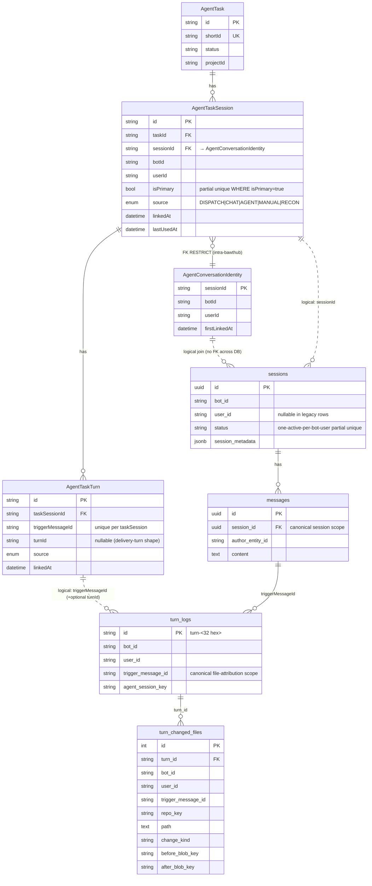
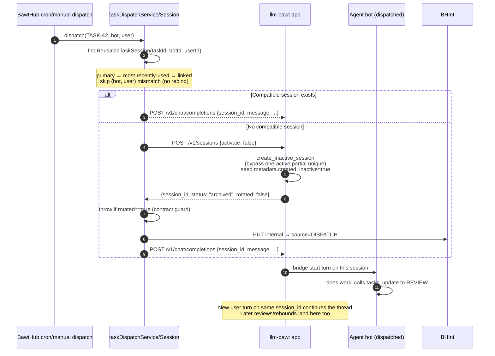
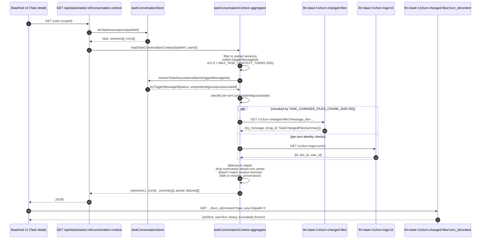
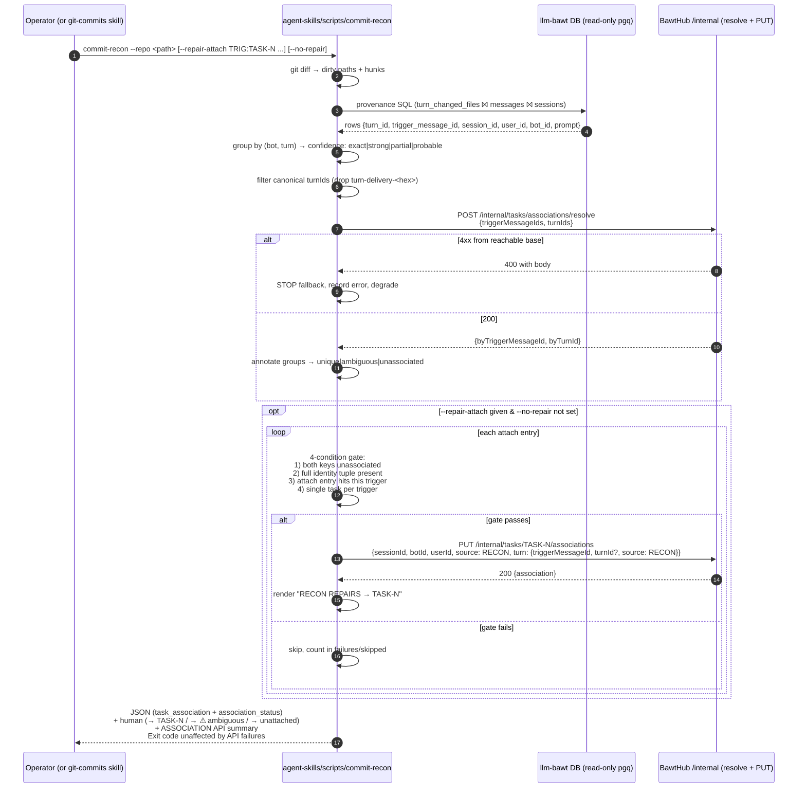

# Task ↔ Conversation Architecture (cross-system reference)

**Canonical description of how BawtHub tasks bind to llm-bawt conversations
and exact turns — spans two databases, four code layers, and the
agent-skills recon workflow.**

Read this before touching:

- The three `Agent*` association tables in BawtHub (schema, routes, aggregator, dispatch resolver).
- llm-bawt session lifecycle (`activate=false`), the trusted current-turn capability,
  `/v1/turn-changed-files*`, or the MCP task tools (`tasks_associate_current`,
  `tasks_update(..., associate_current_turn=true)`, `tasks_create(..., associate_current_turn=true)`).
- `agent-skills/scripts/commit-recon` — the `--repair-attach` mechanism, the resolve
  batch shape, or the association client's fail-closed behavior.
- The `git-commits` skill's task-traceability recon.

Companion documents (subsystem detail lives there, this ref stays the shape):

- `agent-skills/bawthub/SKILL.md` — task data models, public API surface, chat UI.
- `agent-skills/bawthub/references/chatui-architecture.md` — chat concern layout, task-binding hook home.
- `agent-skills/llm-bawt/SKILL.md` — non-activating sessions, MCP task tools, ownership boundary.
- `agent-skills/llm-bawt/reference/data-model.md` — logical ERD across both databases.
- `agent-skills/llm-bawt/reference/history-context-flow.md` — ordinary vs dispatched vs task-bound flows.
- `agent-skills/git-commits/SKILL.md` — commit-recon's role in the pipeline; recon flow = diagram 5.

## Purpose and ownership boundary

The system creates durable associations at **two grains**:

1. **Task ↔ session** — reopens history and continues work in the same
   conversation. Navigation.
2. **Task ↔ exact turn** — attributes changed files, commits, and audit trail
   without conflating an entire mixed-use session with one task. Attribution.

Dispatch is only one producer. Ordinary chat ("hey, work on TASK-42") must
associate the current session and turn just as reliably as background dispatch.

Ownership is split across two databases; there are **no cross-database
foreign keys**.

| Database | Owner | Owns |
|---|---|---|
| BawtHub (`echo`) | BawtHub | `AgentTask`, `AgentTaskSession`, `AgentTaskTurn`, `AgentConversationIdentity`, all `AgentTask*` associations |
| llm-bawt (`askllm`) | llm-bawt | `sessions`, partitioned `messages`, `turn_logs`, `turn_changed_files`, immutable before/after diff bytes |

Cross-database identifiers (`sessionId`, `botId`, `userId`, `triggerMessageId`,
`turnId`) are **logical joins** — BawtHub knows the shape, llm-bawt owns the
row. Neither side may add a foreign key across the boundary.

## Diagram 1 — Cross-database ER model (ownership + grain)



**Grain notes:**

- `AgentTaskSession` grain is `(task, session)`. One task ↔ many sessions
  (primary + reopens); one session ↔ many tasks over time (a session may host
  work for several tasks; changed-file attribution stays exact via
  `AgentTaskTurn`).
- `AgentTaskTurn` grain is `(taskSession, triggerMessageId)`. Attribution is
  turn-exact, not session-wide.
- `turn_logs` is the immutable audit record of one LLM turn. Its
  `trigger_message_id` is the canonical join surface for changed files and
  task attribution.
- `turn_changed_files` grain is `(turn_id, repo_key, path)`. The before/after
  bytes are content-addressed (`*_blob_key`) so `/v1/turn-changed-files/{turn_id}/content`
  serves the frozen turn-time file, never a live worktree diff.

## Data model detail

### BawtHub — `frontend/prisma/schema.prisma`, live in the BawtHub DB

```prisma
enum TaskAssociationSource {
  DISPATCH   // background dispatch → task session
  CHAT       // public UI attach/link (user-driven; also default for turn link)
  AGENT      // trusted current-turn capability from an ordinary chat turn
  MANUAL     // public UI attach (user-driven; default for whole-session attach)
  RECON      // commit-recon repair from --repair-attach
}
```

Three tables, all in the bawthub database:

| Table | Grain | Unique | Notable index |
|---|---|---|---|
| `AgentConversationIdentity` | `sessionId` | `sessionId` (PK) | `(botId, userId)` |
| `AgentTaskSession` | `(taskId, sessionId)` | `(taskId, sessionId)` + partial unique `(taskId) WHERE isPrimary=true` | `(taskId, lastUsedAt)`, `sessionId` |
| `AgentTaskTurn` | `(taskSessionId, triggerMessageId)` | `(taskSessionId, triggerMessageId)` | `triggerMessageId`, `turnId` |

Foreign keys (intra-bawthub only — the boundary rule stands):

- `AgentTaskSession.sessionId → AgentConversationIdentity.sessionId ON DELETE RESTRICT`
- `AgentTaskSession.taskId → AgentTask.id ON DELETE CASCADE`
- `AgentTaskTurn.taskSessionId → AgentTaskSession.id ON DELETE CASCADE`

**Why the identity table exists** (this is the nuance vs the original proposal):
`AgentConversationIdentity` is a durable ownership anchor. It survives every
task detach — because `AgentTaskSession → AgentConversationIdentity` is `ON
DELETE RESTRICT`, no code path can remove the identity row while any task
still references the session. Later attempts to link the same sessionId under
a different bot/user hit `ASSOCIATION_CONFLICT` at
`taskConversationStore.upsertTaskAssociation`. So the sessionId's bot/user
provenance is immutable once claimed. **No cross-database FK is created —
this is an intra-bawthub FK to a durable identity row.**

The one-primary-per-task rule is enforced at the DB, not just the app:

```
AgentTaskSession_one_primary_per_task
  UNIQUE btree (taskId) WHERE (isPrimary = true)
```

(Declared in `frontend/prisma/sql/2026_08_02_task_conversation_associations.sql`
because Prisma cannot express a filtered unique index.)

### llm-bawt — live in askllm DB

`sessions` (verified live via `pgq llm-bawt`):

- PK `id` (canonical UUID string, cased lowercase everywhere on the write paths).
- `status` — `active | archived | deleted`.
- **`idx_sessions_one_active_per_bot_user UNIQUE btree (bot_id, user_id)
  NULLS NOT DISTINCT WHERE status='active'`** — the one-active-per-(bot, user)
  invariant that `activate=false` bypasses.
- `session_metadata jsonb` — includes `created_inactive: true` marker on
  non-activating threads, plus `agent_session_keys.<backend>` for SDK resume.

`messages` (partitioned) — canonical session scope via `session_id`. Owns
message identities. `messages.id` is what `triggerMessageId` refers to.

`turn_logs`:

- PK `id` (`turn-<32 hex>`).
- Indexed: `trigger_message_id` — the canonical exact-turn key.
- **Deliberately has no `session_id` column** (see invariant 3 below).

`turn_changed_files` (TASK-661):

- Rich provenance: `turn_id, bot_id, user_id, trigger_message_id, repo_key,
  path, old_path, change_kind, additions, deletions, before/after
  {sha256, bytes, blob_key}, content_type, source_tool_call_ids,
  commit_requested_at`.
- Bounds enforced app-side (`service/changed_files_store.py:51-52`):
  `MAX_FILES_PER_TURN = 200`, `MAX_BYTES_PER_SIDE = 1 MiB`.

## Trust model — three write surfaces, one boundary

### 1. Internal listener (network-bounded, `INTERNAL_PORT`)

Mounted only on the internal port; every `/internal/*` path on the main port
returns explicit 404 via `taskConversationPublicDenialRoutes`. No per-endpoint
auth (TASK-793 removed the TASK-701 bearer): the internal port is never
published beyond the docker network, and that network boundary is the auth
layer — consistent with the rest of the stack. Accepts **all 5 sources** —
this is where trusted runtime code writes.

| Method | Route | Purpose |
|---|---|---|
| `GET` | `/internal/tasks/:taskRef/associations` | List task's sessions + turns |
| `PUT` | `/internal/tasks/:taskRef/associations` | Upsert association (session and optional turn) |
| `POST` | `/internal/tasks/associations/resolve` | Batch resolve identifiers → task classification |
| `PUT` | `/internal/tasks/:taskRef/associations/sessions/:sessionId/primary` | Promote session to primary |
| `DELETE` | `/internal/tasks/:taskRef/associations/sessions/:sessionId` | Unlink whole session |
| `DELETE` | `/internal/tasks/:taskRef/associations/sessions/:sessionId/turns/:triggerMessageId` | Unlink one turn |

Batch resolve bounds (in `frontend/server/lib/taskConversationValidation.ts`):
`MAX_BATCH_INPUT_ITEMS` (input dedupe ceiling) and `MAX_BATCH_IDS` (unique
identifier ceiling). Trigger message IDs must be canonical UUIDs; turn IDs
must match `turn-<32 hex>`. Delivery-shape turn ids (`turn-delivery-<hex>`) are
rejected upstream by clients — see invariant 15.

### 2. Public app (main port, user-scoped, restricted whitelist)

Public write source whitelist is `{MANUAL, CHAT}` only — enforced by
`PUBLIC_SOURCES` at `frontend/server/routes/task-link.ts:44`. Public writers
cannot set `AGENT | DISPATCH | RECON`.

Identity gate for every public write:

1. Header-resolved `entityId` (trusted proxy) wins when present and not `_anonymous`.
2. Client-supplied `?userId=` query param (dev/LAN fallback where no proxy injects headers).
3. 401 otherwise.

Ownership verification is out-of-band, via llm-bawt:
`GET /v1/sessions/:id?bot_id=<hint>&user=<callerUserId>`. The response
`bot_id` becomes authoritative for the association write; the client body's
`botId` is a hint only. A `null user_id` on the session is treated as
**not owned** (fail closed — TASK-705 al fix). Foreign-owned and nonexistent
sessions both collapse to a uniform 404 so a caller cannot enumerate.

| Method | Route | Default source |
|---|---|---|
| `GET` | `/api/tasks/tasks/:taskRef/conversation-context` | — |
| `PUT` | `/api/tasks/tasks/:taskRef/conversation-context/sessions/:sessionId` | `MANUAL` |
| `PUT` | `/api/tasks/tasks/:taskRef/conversation-context/sessions/:sessionId/turns/:triggerMessageId` | `CHAT` |
| `PUT` | `/api/tasks/tasks/:taskRef/conversation-context/sessions/:sessionId/primary` | — |
| `DELETE` | `/api/tasks/tasks/:taskRef/conversation-context/sessions/:sessionId` | — |
| `DELETE` | `/api/tasks/tasks/:taskRef/conversation-context/sessions/:sessionId/turns/:triggerMessageId` | — |

The GET route is purpose-built: it never returns trigger-message IDs,
association row IDs, source metadata, or another user's sessions. All
provenance keys stay inside the aggregator.

### 3. Trusted current-turn capability (Fernet, 6 h TTL)

**Header:** `X-LLM-Bawt-Task-Turn-Context`
**TTL:** `6 * 60 * 60` seconds
**Payload:** Fernet-encrypted JSON
`{session_id, turn_id, trigger_message_id, bot_id, user_id, issued_at}`
**Key:** shared Fernet key from `service/providers/crypto._get_fernet()`
(`LLM_BAWT_SECRET_KEY` / keyfile).

Mint site: `src/llm_bawt/service/chat_streaming.py`. Three
preconditions, all required:

1. `is_agent_backend` for this bot
2. `backend_name` is `claude-code` or `codex`
3. `session_id` populated from the resolved `thread_binding`

Mint failure logs a warning; **the chat turn is never blocked over
association plumbing**. The MCP tool fails closed later with a clear error.

Verify site: `mcp_server/task_association.py`. `TaskTurnCapabilityMiddleware`
binds the header from the ASGI scope to a `ContextVar` for one request only.
`open_task_turn_context()` verifies the Fernet token, revalidates the
payload shape, then `associate_current_task()` PUTs to the internal listener
(no bearer since TASK-793 — network-bounded).

## Diagram 2 — Ordinary-chat association (trusted capability path)

```mermaid
sequenceDiagram
    autonumber
    participant User
    participant BawtHubUI as BawtHub UI
    participant App as llm-bawt app
    participant Redis
    participant Bridge as claude-code / Codex bridge
    participant SDK as Agent SDK
    participant MCP as llm-bawt MCP server
    participant BHInt as BawtHub /internal (INTERNAL_PORT, network-bounded)

    User->>BawtHubUI: "work on TASK-42"
    BawtHubUI->>App: POST /v1/chat/completions
    Note over App: if agent_backend + supported bridge<br/>+ thread_binding.session_id
    App->>App: mint_task_turn_context(session, turn, trigger, bot, user)
    App->>Redis: XADD command fields<br/>{task_turn_capability, ...}
    Redis->>Bridge: XREADGROUP
    Note over Bridge: Claude stamps each tool input;<br/>Codex signs request identity in a subprocess env
    Bridge->>SDK: request-local MCP header environment
    SDK->>MCP: HTTP call w/ header
    MCP->>MCP: middleware binds header → ContextVar
    Note over SDK: agent calls<br/>tasks_associate_current("TASK-42")
    MCP->>MCP: open_task_turn_context() verifies Fernet
    MCP->>BHInt: PUT /internal/tasks/TASK-42/associations<br/>source=AGENT, turn=exact
    BHInt->>BHInt: upsertTaskAssociation (advisory lock)
    BHInt-->>MCP: 200 {association}
    MCP-->>SDK: {ok, taskRef, association}
    SDK->>SDK: task now bound to this exact turn
```

**Fail-closed points:**

- Mint fails → capability absent → tool returns "No trusted current-turn context is available".
- Header stripped → same error.
- Fernet TTL expired or invalid → tool returns "Current-turn context is invalid or expired".
- Task not found → 404 propagates.
- SessionId ownership conflict (bot/user mismatch with `AgentConversationIdentity`) → 409 `ASSOCIATION_CONFLICT`.

**Detection ≠ authority.** Text pattern-matching for `TASK-N` may suggest an
action or highlight it in the UI, but **never** persists a link — quoted
mentions, negative references, "not TASK-42, this one is different"
phrasing all appear identical to a regex. Every persisted link comes from
one of: the trusted capability, the public user-driven surface, the
internal listener called by dispatch, or `commit-recon --repair-attach`.

## Diagram 3 — Dispatch and non-activating session continuation



**Non-activating semantics** (`llm-bawt/src/llm_bawt/service/routes/sessions.py:82-104,438-453`):

- `POST /v1/sessions {activate: false}` mints a session that is **born
  archived**. It does NOT rotate (close) the user's active thread.
- The response carries `status: "archived"` and `rotated: false`. The
  bawthub dispatch client throws `INVALID_RESPONSE` if it receives
  `rotated: true` — that would be a contract violation (llm-bawt
  accidentally rotated the user's live conversation).
- `session_metadata.created_inactive = true` marks these threads so
  operators can distinguish background/task threads from a UI-archived one.
- Later `/v1/chat/completions` with an explicit `session_id` uses that
  thread even when it's `archived` — the user's active thread is
  untouched.

## Diagram 4 — Task detail → linked turns → changed files → immutable diff



- **Per-turn changed-files status**: `available | no_changes | missing_provenance | unavailable`.
- **Per-turn association status**: `unique | ambiguous | stale`.
- **`partial: true`** with `failures[]` when any chunk failed or turn lookup
  errored — the response degrades but never fabricates attribution.
- Diff bytes are **immutable turn-time content**, not live worktree — that's
  what makes past changed-files rows still meaningful after the working tree
  moves on.

## Diagram 5 — commit-recon dirty hunk → turn → task resolution/repair



**Key behaviors:**

- `--repair-attach TRIGGER:TASK-N` is repeatable. **The operator (or the
  git-commits skill) picks the task; recon executes on a 4-condition gate.**
  Recon never invents a task from regex.
- `--no-repair` runs strictly read-only.
- Non-canonical turn ids (`turn-delivery-<hex>` from `bots_send_message`
  deliveries) are filtered from BOTH the resolve batches and the PUT bodies
  — link via `trigger_message_id` alone.
- 4xx from a reachable base halts fallback (otherwise a Bad Request would
  masquerade as "connection refused" when the client next tried
  `localhost:3002`).
- Association API failures never affect the recon exit code; commit flows
  never stall over recon.

## MCP task tool contract

Registered in `src/llm_bawt/mcp_server/task_tools.py`. Available in every
harness that mounts the llm-bawt MCP server; the trusted current-turn path
is available on claude-code and Codex bridges.

| Tool | Contract |
|---|---|
| `tasks_associate_current(task_id)` | Trusted-only. Reads Fernet capability from the MCP HTTP header via `ContextVar`; PUTs `source: AGENT` to the internal listener. Fails closed on absent/expired capability. Never accepts identifiers as arguments. |
| `tasks_update(task_id, ..., associate_current_turn=true)` | Applies the update, then attempts association. If no update fields are passed, falls through to the association-only branch (still `source: AGENT`). Association result attached as `currentTurnAssociation` in the response; a failure there does not fail the update. |
| `tasks_create(..., associate_current_turn=true)` | Creates the task, then attempts association against the returned `shortId`. Same failure semantics. |

**Detection is never authority** — the MCP docstrings state this explicitly.
A bot noticing `TASK-42` in a prompt may call `tasks_associate_current`
after judging that the current work truly belongs to that task; it must not
call it merely because the string appears in a quote or negative reference.

## Verified invariants (16)

Each invariant anchored to source or live-schema receipts.

1. **No cross-DATABASE FK.** BawtHub owns association tables in `echo`;
   llm-bawt owns conversation tables in `askllm`; every join between them
   is logical. **The intra-bawthub `AgentTaskSession → AgentConversationIdentity`
   FK is by design and does not violate this** — both tables live in the
   bawthub database.
2. **No changed-file duplication in BawtHub.** The task-context aggregator
   reads llm-bawt on demand and never persists what it retrieves.
3. **`messages.session_id` is the canonical session scope. `turn_logs` has
   NO `session_id` column** (verified live via `pgq llm-bawt`). Do **not**
   add one. *Do not misread the `session_id` request param on
   `/v1/turn-changed-files/uncommitted` and `/v1/turn-changed-files/commit-requested`
   as evidence for a column* — it is a caller convenience resolved through
   the canonical session scope (`changed_files_store._resolve_session_id`
   verifies the session belongs to `(bot_id, user_id)` OR joins from an
   anchor turn's `turn_changed_files → messages → session_id`). Column
   absence is the invariant; the param is a convenience.
4. **`trigger_message_id` (+ optional `turn_id`) are the canonical exact-turn
   keys** for attribution. `turn_changed_files.trigger_message_id` and
   `turn_logs.trigger_message_id` are the join surfaces; `turnId` on
   `AgentTaskTurn` is nullable to accommodate the delivery-shape asymmetry
   (see invariant 15 and the deferred ledger).
5. **One-primary-per-task partial unique index enforced at the DB.**
   `AgentTaskSession_one_primary_per_task UNIQUE btree (taskId) WHERE
   isPrimary=true` — an app bug cannot create two primaries.
6. **Session identity is immutable once claimed.** `AgentConversationIdentity`
   row survives task detach (FK RESTRICT); `upsertTaskAssociation` throws
   `ASSOCIATION_CONFLICT` on bot/user mismatch. No sessionId can be
   re-bound to different provenance after first use.
7. **Public write source whitelist is `{MANUAL, CHAT}` only.**
   `AGENT | DISPATCH | RECON` require the internal listener (container-only port).
8. **Ordinary-chat trusted association is available on claude-code and Codex
   bridge turns.** Claude supplies an exact per-call stamp. Codex carries a
   signed request envelope in request-local subprocess environment variables,
   mapped to MCP HTTP headers, and the server binds it to the JSON-RPC request
   ID. Those environment variables are excluded from model-invoked shell
   subprocesses.
9. **Detection is never authority.** No route, tool, or script persists a
   task link merely because `TASK-N` text was matched.
10. **Multiple task associations on one turn surface as `ambiguous`.**
    Never silently picked; the aggregator returns `ambiguousTaskRefs[]`;
    commit-recon renders `→ ⚠ ambiguous:` and lets the operator split.
11. **`activate=false` never rotates the user's active thread.** The
    dispatch client throws `INVALID_RESPONSE` if llm-bawt returns
    `rotated: true` for a non-activating request — a contract violation
    caught in the client rather than corrupting live conversations
    silently.
12. **Immutable diff bytes.** `/v1/turn-changed-files/{turn_id}/content`
    serves the turn-time frozen file (content-addressed via
    `before_blob_key` / `after_blob_key`), not the live worktree.
13. **Foreign session vs nonexistent is uniform 404 on public writes.**
    A caller cannot enumerate other users' sessions via probe.
14. **Case-normalized (lowercase) session/message/turn IDs** on every
    write path — bawthub store `.toLowerCase()`s at every boundary;
    llm-bawt canonicalizes on read.
15. **Delivery-shape turn IDs (`turn-delivery-<hex>`) are filtered** from
    association batches. Attribution rides on `trigger_message_id` alone
    for those turns; `AgentTaskTurn.turnId` stays null for them.
16. **Association API failures never block recon or commits.** Warn +
    heuristic-only degrade; exit code unaffected (enforced by
    `ExitCodeInvariantTests` in `test_commit_recon.py`).

## Failure modes and degrade behavior

| Failure | Where it lands | Behavior |
|---|---|---|
| llm-bawt mint site cannot resolve session | `chat_streaming.py:347-373` | Log warning, no header sent, MCP tool fails closed with clear error. Turn proceeds. |
| Fernet TTL expired | `open_task_turn_context()` | `TaskTurnContextError: Current-turn context is invalid or expired` |
| Session bot/user mismatch on write | `upsertTaskAssociation()` | 409 `ASSOCIATION_CONFLICT` — never silently rebinds. |
| Public write on foreign-owned session | `task-link.ts loadOwnedSession()` | Uniform 404 — no existence leak. |
| Task context aggregator upstream fetch fails | `taskConversationContext.ts` | `partial: true`, `failures[]` populated, affected turns → `unavailable`. |
| Non-activating session request returns `rotated: true` | `taskDispatchSession.ts` | `INVALID_RESPONSE` — dispatch marks task FAILED rather than corrupting the active thread. |
| commit-recon association API 4xx from reachable base | `AssociationClient._request_json` | Stop fallback; record body prefix; degrade to heuristic-only. |
| commit-recon association API unreachable | Same | Warn to stderr; heuristic-only; exit code unaffected. |
| commit-recon `--repair-attach` gate fails | `annotate_and_repair_associations` | Skip; count in failures/skipped; human output renders reason. |
| Legacy work with no capability/no manual link | Any read path | Turn shows `stale` or `unassociated`; not repaired until an operator supplies `--repair-attach` or a user attaches through the UI. |

## Deferred / known gaps (tracked, not caveats)

| Gap | Home |
|---|---|
| Mid-turn thread-switch does not project in-flight state; split-view same-bot hydrate falls back to per-bot adoption | `bawthub/frontend/src/app/chat/ARCHITECTURE.md:96-116` (TASK-709 phase 3) |
| `tasks_update(..., associate_current_turn=true)` returned "No trusted current-turn context" for every inter-bot-delivery-dispatched claude-code turn — real root cause was the capability mint's `_TURN_ID_RE` rejecting `turn-delivery-<hex>` ids at `task_turn_context.py:23`, silently swallowed to a warning at `chat_streaming.py:365-373` (the "thread_binding" suspicion in the original task was wrong — thread binding was fine). Fixed by loosening the mint regex to accept both shapes and having `associate_current_task` send `turnId: null` for delivery shapes (matches the existing "PUT bodies filter delivery ids" convention already used by `commit-recon`). | **TASK-783** (fix in REVIEW) |
| TASK-779 — two-emit-site fixed; underlying delta-drop root cause still open | TASK-779 |
| TASK-780 — pytest marker gating | TASK-780 |
| TASK-705 deferred trio — regex toast + negative-ref tests, ambiguous-row per-turn unlink, multi-tab binding sync | Sub-tasks of TASK-705 |
| Delivery-turn attribution asymmetry: `AgentTaskTurn.turnId` is null for `bots_send_message` deliveries. Attribution rides on `trigger_message_id` alone (sufficient for aggregation and recon); no durable turnId for future correlation on those rows | Deliberate — see invariant 15 |

## Verification recipes

Live schema (bawthub):

```bash
pgq bawthub -c '\d "AgentTaskSession"'
pgq bawthub -c '\d "AgentTaskTurn"'
pgq bawthub -c '\d "AgentConversationIdentity"'
pgq bawthub -c "SELECT indexname, indexdef FROM pg_indexes \
  WHERE tablename IN ('AgentTaskSession','AgentTaskTurn','AgentConversationIdentity') \
  ORDER BY tablename, indexname;"
```

Live schema (llm-bawt):

```bash
pgq llm-bawt -c '\d turn_logs'          # trigger_message_id present; session_id absent
pgq llm-bawt -c '\d turn_changed_files'
pgq llm-bawt -c '\d sessions'           # note idx_sessions_one_active_per_bot_user
```


commit-recon end-to-end (dry-run repair via file):

```bash
commit-recon --repo ~/dev/bawthub --json --repair-out-file /tmp/repair.json \
  --repair-attach <trigger>:TASK-706
```

## File map

BawtHub — the association surface:

- `frontend/prisma/schema.prisma:177-311` — enum + 3 tables.
- `frontend/prisma/sql/2026_08_02_task_conversation_associations.sql` — partial unique index.
- `frontend/server/lib/taskConversationStore.ts` — upsert / list / resolveBatch / setPrimary / unlink.
- `frontend/server/lib/taskConversationContext.ts` — aggregator (chunk + concurrency + defense-in-depth).
- `frontend/server/lib/taskConversationValidation.ts` — canonical UUID / turn id / batch bounds.
- `frontend/server/lib/taskDispatchSession.ts` — reuse-or-create-inactive dispatch resolver.
- `frontend/server/routes/task-conversations.ts` — internal listener + public denials.
- `frontend/server/routes/task-link.ts` — public attach/unlink/link (MANUAL|CHAT).
- `frontend/server/routes/task-primary.ts` — public set-primary.
- `frontend/server/routes/task-context.ts` — public browser context (purpose-built).

llm-bawt — the trusted capability + conversation surface:

- `src/llm_bawt/task_turn_context.py` — Fernet mint/open + header constant + TTL.
- `src/llm_bawt/service/chat_streaming.py` — mint site (claude-code + Codex).
- `src/llm_bawt/service/turn_stream_worker.py:539-542` — capability into agent kwargs.
- `src/llm_bawt/clients/agent_backend_client.py:218-235` — kwarg → config → Redis.
- `src/llm_bawt/agent_bridge/subscriber.py:162,231-234` — Redis fields.
- `src/claude_code_bridge/send_request.py:161-192` — pop from fields.
- `src/claude_code_bridge/send_handler.py:77,362` — forward to stream.
- `src/claude_code_bridge/send_stream.py:205-213` — set MCP HTTP header.
- `src/codex_bridge/mcp_context.py` — per-request signed Codex envelope.
- `src/codex_bridge/local_plugins.py` — Codex `env_http_headers` mapping.
- `src/llm_bawt/mcp_server/task_association.py` — middleware + `associate_current_task()`.
- `src/llm_bawt/mcp_server/task_tools.py` — MCP task tool contracts.
- `src/llm_bawt/service/routes/sessions.py:82-104,438-453` — `activate=false` semantics.
- `src/llm_bawt/service/routes/turn_logs.py:741-762,807-833` — `/v1/turn-changed-files*`.
- `src/llm_bawt/service/changed_files_store.py` — provenance store + `_resolve_session_id`.

agent-skills — the recon integration:

- `scripts/commit-recon` (same inode as `/opt/agent-skills/bin/commit-recon`)
  — `AssociationClient`, `--repair-attach`, `--no-repair`, 4-condition gate.
- `scripts/test_commit_recon.py` — offline fixtures incl. `ExitCodeInvariantTests`.
- `scripts/README.md` — flag/env-var reference.
- `git-commits/SKILL.md` — commit-recon in the traceability recon (this is diagram 5).

## Diagram edits — invariants ranked over prettiness

If a diagram edge is wrong, fix the diagram before shipping. A prettier
diagram that lies is worse than an ugly one that tells the truth — future
agents rebuild mental models from these, not from bytes-first re-reads.
